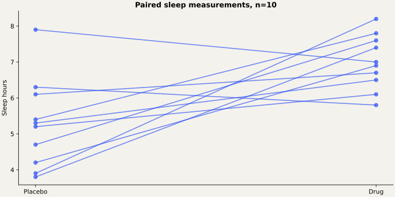

# Sleep Treatment Response

Paired inference, confidence intervals, and power analysis for drug-versus-placebo sleep measurements.

## The question

Do paired drug and placebo measurements differ in sleep hours, and how sensitive is a small study to plausible effects?

## Approach

Uses 10 paired observations. Removes a reference to nonexistent sleep_data and redundant repeated tests. Retains the original two-sided test and planning assumptions; adds a clearly labeled one-sided sensitivity analysis. Small-sample conclusions depend on the distribution of paired differences.

## Findings

The paired mean increase is 1.72 hours (95% CI 0.481–2.959). The original two-sided paired test gives t=3.1405, df=9, p=0.01192. The observed Drug/Placebo correlation is negative (-0.4423), correcting the sign used in the original power assumptions.

See `validation/results.md` for full numeric evidence.

## Run in SAS

Requires SAS 9.4 with SAS/STAT and ODS Graphics (or an equivalent licensed SAS Studio environment).

1. Download/clone this repository.
2. Set `project_root` in `src/config.sas` to its absolute directory.
3. Open `run.sas`. If SAS is not started in the repository directory, change its first `%include` to the absolute path to `src/config.sas`.
4. Submit the whole program. The HTML report is written to `outputs/analysis.html`.
5. Review the SAS log for errors and warnings before interpreting results.

## Repository guide

- `src/analysis.sas`: analysis procedures and explanatory comments.
- `src/config.sas`: one root-path setting and shared execution checks.
- `data/`: analysis inputs and schema/provenance notes.
- `docs/`: methods and recovery decisions.
- `validation/`: independent numerical checks when inputs are available.

## Validation status

Independent calculations are documented in `validation/results.md`. SAS runtime execution is pending because SAS is not installed in the preparation environment.

## Authorship and provenance

Analysis supplied by Abhinav Tanwar; packaging and source recovery are documented in `docs/provenance.md`. These are analytical portfolio projects. No employer affiliation or production deployment is implied. Data retain their original ownership; no dataset license is invented.
